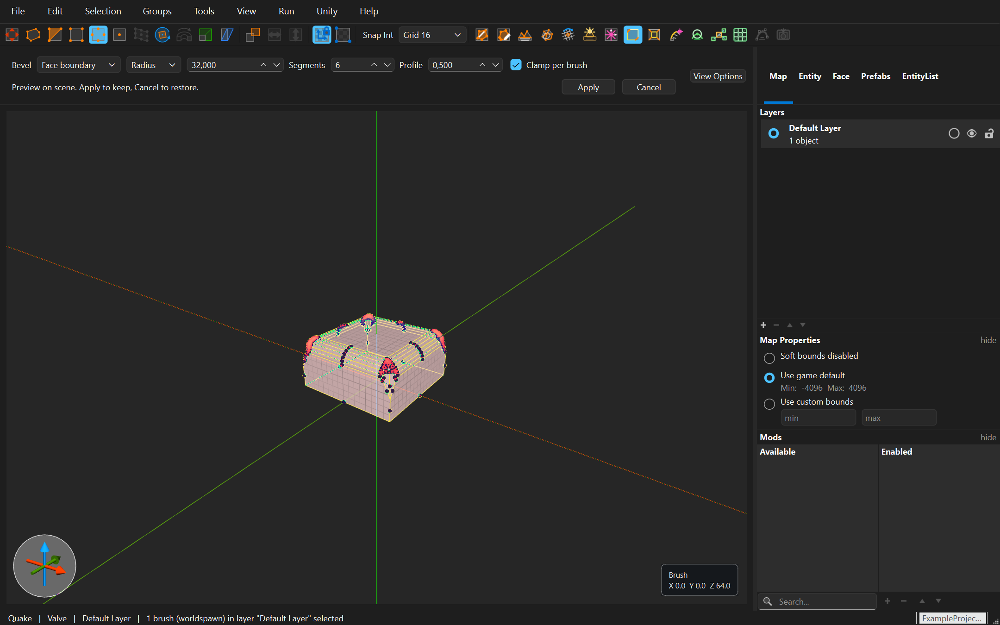

# ReyondBroom

**Самостоятельный 3D-редактор уровней для игр с брашевой геометрией.** Стройте пространство, создавайте архитектуру, настраивайте текстуры и размещайте игровые сущности — от первой комнаты до детальной игровой карты.

[English](README.md) · **Русский** · [Руководство с иллюстрациями](https://reyond9079.github.io/ReyondBroom/index.ru.html) · [Полный справочник (EN)](https://reyond9079.github.io/ReyondBroom/reference.html) · [Релизы и контрольные суммы](https://github.com/reyond9079/ReyondBroom/releases/latest)

## Всё для построения уровня

- **Редактирование в 3D и 2D.** Примитивы, вершины, рёбра, грани, отсечение, экструзия, Sweep, масштаб и скос. Патчи Quake 3 с управляющими точками в поддерживаемых форматах.
- **Архитектура и ландшафт.** Вырезы и объёмы по контуру, рамки Inset, изгиб групп, цепочки экструзий, разбиение поверхностей, скульптинг, генерация рельефа и камней.
- **Скругление и разрушение.** Bevel по внешнему контуру граней, рёбрам или вершинам с радиусом, сегментами, выпуклым профилем и Clamp. Раскол Fracture, сквозные отверстия Perforate и укладка Settle с гравитацией и столкновениями.
- **Повторение и точность.** Линейные, круговые и случайные массивы, симметрия, поворот сетки, целочисленная привязка и точные XYZ-координаты.
- **Текстуры и организация.** UV-редактор, коллекции материалов, папки текстур, палитры экспорта WAD, префабы и поиск EntityList. Группы, связанные группы и слои помогают работать с большими картами.
- **Предпросмотр и экспорт.** Приблизительный свет и небо Quake, движение сущностей и маршруты поездов. Внешние компиляторы, диагностика, поиск утечек, запуск игры и синхронизация геометрии с текстурами в Unity.

ReyondBroom развивается независимо, имеет собственные релизы и документацию. Он устанавливается как полноценная программа; другой редактор для работы не нужен.

## Начало работы

1. **Установите редактор.** В Windows распакуйте весь ZIP и запустите `TrenchBroom.exe` — это текущее имя исполняемого файла. Сохраните рядом ресурсы и DLL. В Linux разрешите запуск AppImage; при отсутствии FUSE добавьте `--appimage-extract-and-run`.
2. **Выберите игру.** Создайте карту в совместимом формате, укажите каталог игры, мод и определения сущностей. Игровые ресурсы и компиляторы устанавливаются отдельно.
3. **Постройте комнату.** Создайте пол, стены и потолок, добавьте точку старта и свет, назначьте материалы и сохраните карту.
4. **Соберите и проверьте.** Настройте **Run → Compile** под инструменты вашей игры. До детализации проверьте результат в движке.

[Пошаговая первая карта с иллюстрациями →](https://reyond9079.github.io/ReyondBroom/index.ru.html#first-room)

Готовые сборки доступны для Windows x64 и Linux x86_64. AppImage проверяется на Ubuntu 24.04; старые дистрибутивы не проверены. macOS-билда в текущем релизе нет.

## Руководство по инструментам

| Задача | Инструкция |
| --- | --- |
| Навигация, выделение, построение и текстуры | [Начало работы](https://reyond9079.github.io/ReyondBroom/index.ru.html#start) |
| Скруглить рёбра и углы | [Bevel](https://reyond9079.github.io/ReyondBroom/index.ru.html#bevel) |
| Разбить стену и уложить обломки | [Fracture](https://reyond9079.github.io/ReyondBroom/index.ru.html#fracture) · [Settle](https://reyond9079.github.io/ReyondBroom/index.ru.html#settle) |
| Создать случайные сквозные отверстия | [Perforate](https://reyond9079.github.io/ReyondBroom/index.ru.html#perforate) |
| Создать ландшафт и криволинейные конструкции | [Terrain](https://reyond9079.github.io/ReyondBroom/index.ru.html#terrain) · [Bezier Bend](https://reyond9079.github.io/ReyondBroom/index.ru.html#bezier-bend) · [Spin](https://reyond9079.github.io/ReyondBroom/index.ru.html#spin) |
| Повторять модули и размещать заготовки | [Array](https://reyond9079.github.io/ReyondBroom/index.ru.html#array-line) · [Symmetry](https://reyond9079.github.io/ReyondBroom/index.ru.html#symmetry) · [Prefabs](https://reyond9079.github.io/ReyondBroom/index.ru.html#prefabs) |
| Собрать, проверить и экспортировать | [Компиляция](https://reyond9079.github.io/ReyondBroom/index.ru.html#compile) · [Unity Sync](https://reyond9079.github.io/ReyondBroom/index.ru.html#unity-sync) |

Руководство содержит одинаковый набор глав на английском и русском: шаги, параметры, ограничения, скриншоты и поиск. Полный технический справочник по базовому редактору, выражениям и конфигурациям игр доступен на английском. [Исходники документации и инструкция локальной сборки](docs/README.md) находятся в репозитории.

## Игры и форматы

Предусмотрены конфигурации Quake, Quake 2, Quake 3, Hexen 2, Daikatana и собственных движков. Форматы карт, материалы, классы сущностей и патчи зависят от конфигурации. Поддерживаются Quake Standard и Valve 220. Выбирайте формат, который понимает ваш компилятор; предпросмотр не заменяет проверку готовой карты в игре.

## Разработка и справочная информация

Рабочая ветка — **ReyondBroom**. Инструкции сборки и правила репозитория находятся в [BUILD.md](BUILD.md), [CONTRIBUTING.md](CONTRIBUTING.md) и [AGENTS.md](AGENTS.md).

Происхождение проекта и иллюстраций собрано в одном разделе [«Источники и лицензии»](https://reyond9079.github.io/ReyondBroom/sources.html). Лицензия — [GPL-3.0-or-later](LICENSE.txt); исходные уведомления и [лицензии сторонних компонентов](THIRD_PARTY_NOTICES.ru.md) сохранены.
